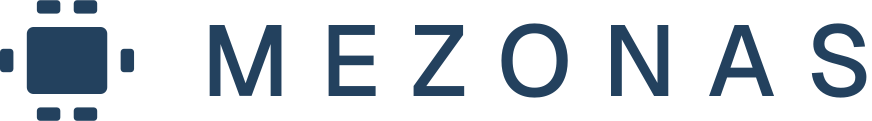

# Mezonas design system

Drop this folder into the repo (for example `packages/design-system/` or `src/design-system/`). Plain CSS, no framework, no build step.

## Use it

```html
<link rel="stylesheet" href="/design-system/tokens.css">
<link rel="stylesheet" href="/design-system/components/bundle.css">
<link rel="icon" href="/design-system/assets/Logos/favicon.svg">
<link rel="apple-touch-icon" href="/design-system/assets/Logos/apple-touch-icon-180.png">
```

- `tokens.json` — the source of truth (colors in light and dark, type, spacing, radius, shadow, layout). `tokens.css` is generated from it: CSS custom properties plus `.type-*` classes and the Geist `@font-face` rules.
- `components/bundle.css` — every component class (`ds-*`, `dt-*`, `mz-*`). Each `components/<Name>/` has a README (what the consumer provides) and a `preview.html` with copyable markup. Open `index.html` through a local server to browse them all.
- `assets/Logos/` — every logo variation, wordmark outlined. `assets/Icons/` — 36 `mz-*.svg` icons and `mezonas-icons-sprite.svg` (`<svg><use href="#mz-check"/></svg>`).
- `fonts/` — Geist and Geist Mono variable fonts (SIL Open Font License, `fonts/OFL-Geist.txt`). Delete the `@font-face` lines in `tokens.css` if you load them from Google Fonts or the `geist` npm package instead.
- Dark theme: follows the OS, or force it with `<html data-theme="dark">` (`data-theme="light"` forces light). Use the `-paper` logo files and inline icons on dark grounds.
- Tailwind or JS tokens: read `tokens.json`; every token name maps one-to-one to `var(--<name>)`.

For an AI coding agent, point it at this README and the brand book below, and tell it to build with these tokens and classes rather than new colors or fonts.

---

# Brand book

Mezonas runs the back-office work a business doesn't have time for. Agents do the work; people at the table check it and sign it. The name comes from *mesón*, Spanish for a counter or worktop: the surface where work is laid out, checked and finished. Mezonas is a Twelve Thirty-Four company.

Everything in this identity says two things: the work is on the table, nothing hidden, and people are at the table, someone accountable. Slate carries the brand, copper marks people, gold marks what waits on you.

## Voice

Mezonas sounds like a sharp operations team you trust. Plain words, short sentences, no jargon.

- Say what was done, show the work, name what needs a decision: "Four customers haven't paid in 45 days. We drafted the reminders. Sign and they go out today."
- Lead with the result and its number: "Baltic birch is up 12% at one vendor this month."
- Use "we" for Mezonas and "you" for the client. Name the person: "Checked by Ana, your Mezonas lead."
- Sentence case everywhere except the wordmark and `eyebrow` text.
- Never: hype, exclamation marks, emoji, "AI-powered", "revolutionary", robots or brains. The agents are how the work gets done; the people are the pitch.

Taglines: lead with **Everything on the table.** Alternates: "People at the table. Work on the table." and "We do the work. You make the call."

## Name and logo



- The mark is a table seen from above with six seats: the work in the middle, people around it. It is always one color: the table and every seat match. Never color the seats differently, and never use copper or gold in the logo.
- The wordmark is MEZONAS in Geist 500, capitals, tracked 300. It ships outlined in the logo files; don't retype it.
- Use the files in the Logos group. Default: `mezonas-logo.svg` (slate). On slate or dark grounds: the `-paper` files. One-color print: `-ink`, `-black`; on photos: `-white`.
- Lockups: horizontal (default), stacked (square and centered spaces), wordmark only, mark only, and endorsed with "a Twelve Thirty-Four company" (footers, contracts).
- Under 24px use the small mark (`mezonas-mark-small.svg`, four seats). Favicons: `favicon.svg`, `favicon-16/32/48.png`. App icon: `mezonas-app-icon.svg` (slate square, radius 22%) and `apple-touch-icon-180.png`.
- Clear space: one seat length, about 15% of the mark's width, on every side. Minimum: mark 16px, horizontal lockup 96px wide, stacked 64px wide; print 25mm.
- Don't rotate the mark, add or remove seats, set the wordmark in another face or lowercase, or put the logo in any container but the app-icon square or avatar circle.
- In running text the name is "Mezonas", capital M only.

## Color

- `paper` is the ground; content sits on `surface` cards with a `line` hairline, like sheets on a table. `line-strong` for input and control borders.
- `slate` is the brand: primary actions, links, selection, the logo. Text on a slate fill is `on-slate`. `slate-tint` marks the selected row and the active nav item.
- `copper` marks people: the Mezonas lead, human sign-offs, notes from a person. Agents' work stays in `ink`; a person's touch is copper. The lead's avatar is `copper-ink` initials on `copper-tint`.
- `signal` (gold) means it's waiting on you: approvals, price changes, overdue items. It is a fill with `ink` text, or `signal-ink` on `signal-tint`; never gold text on paper (2:1). Always pair it with a word ("Waiting on you", "Up 12%").
- `risk` is for errors and real risk; `positive` for done, paid and signed. Both always carry a word.
- Text pairs meet 4.5:1 in both themes on the grounds their notes name; `ink-faint` is placeholders only. Keyboard focus is `focus-ring`: a solid 2px slate ring with a 2px `paper` gap.

## Type

- Geist (`sans`) for everything a person reads: `display` for the site hero, `title` for page titles, `heading`, `subheading`, `body`, `small` and `label` in the app. Headlines run tight (negative tracking).
- Geist Mono (`mono`) for `eyebrow` kickers and `reference` text only: invoice numbers, record IDs, page references on Receipts.
- Every amount uses tabular figures (`font-variant-numeric: tabular-nums`), right-aligned in tables.
- Two weights in the app, 400 and 500; 600 only for `subheading` and the Sign button. Both families load from Google Fonts.

## Layout and shape

- A strict 12-column grid, 24px gutter, 1200px max. Page margins `space-16` desktop, `space-6` tablet, `space-4` phone. `space-6` card padding; `space-10` between app sections, `space-24` between site sections.
- Content is squared and aligned, never scattered or tilted. `radius-md` for buttons, cards and tables; `radius-lg` for The Table's main surface, dialogs and large panels; `radius-sm` for inputs and tags; `radius-pill` for status pills and count badges only.
- Borders, not shadows. A card is `surface` with a `line` hairline. `shadow-pop` lifts only menus, popovers, dialogs and toasts.

## Iconography

- Use the Mezonas set in the Icons group: 36 icons, `mz-<name>.svg`, plus `mezonas-icons-sprite.svg` with one `<symbol id="mz-<name>">` per icon.
- Drawn on a 24px grid with 2px padding, 1.5px stroke at every size, square caps, miter joins, outline only. Sizes 16, 20 and 24px.
- Color with `currentColor`: `ink-muted` at rest, `ink` on hover, `slate` when active, `on-slate` on slate fills. Inline the SVG or use the sprite; an `` renders the stroke black.
- An icon always sits beside a label or inside a titled icon button. Words come first.
- `mz-table` is the only icon that echoes the mark; no other icon uses seats.

## Components

Built from Groundwork v0.1 and rethemed: plain CSS, no framework. Load `tokens.css`, then `components/bundle.css` (the `ds-*`, `dt-*` and `mz-*` classes and `.type-*` styles). Copy any component's markup from its live preview; its guidelines say what the consumer provides.

- Mezonas service: `SignCard` (the approval on Your Desk), `WorksheetRow`, `ReceiptChip`, `PersonChip`, `TeamMarker` (work the team drafted, before the lead checks it), `ThreadMessage`, `NotesRail`.
- Core: Button, TextField, Select, Checkbox, Radio, Switch, Segmented, Tabs, StatusPill, Tag, Avatar, Card, ListRow, StatCard, EmptyState, Banner, Dialog, SideSheet, Toast, Tooltip, AppHeader, Sidebar, Stepper.
- Data tables, picked by the reader's job and never mixed in one table: `TableLedger` to check and export, `TableAnalytical` to spot outliers, `TableGrouped` to drill into segments, `TableHeatmap` to compare across periods. Numbers right-aligned with tabular figures; only marks use `data-*` colors.
- Icons and logos shown through `` keep their file color; in the dark theme use the `-paper` logo files and inline SVG icons.

## Imagery

- Real people at a real table, shot top-down or over the shoulder: hands, laptops, papers, a phone, coffee. Small businesses as they are, not staged offices.
- No stock handshakes, no robots, no glowing networks, no gradients.

## Service language

Use these names wherever the client sees the service:

| Name | What it is |
| --- | --- |
| The Table | The client's home: everything in play this week |
| Your Desk | Only what waits on the client: approvals and questions |
| Sign | Approving an action, shown with before and after |
| Worksheet | Each step taken, by whom, with sources |
| Receipts | The document, email or record behind a result |
| The Weekly Table | The Monday summary from the Mezonas lead |
| Your Mezonas lead | The named person accountable for the account |
| The team | The named agents working alongside the lead, e.g. "Pia, Purchasing" |
